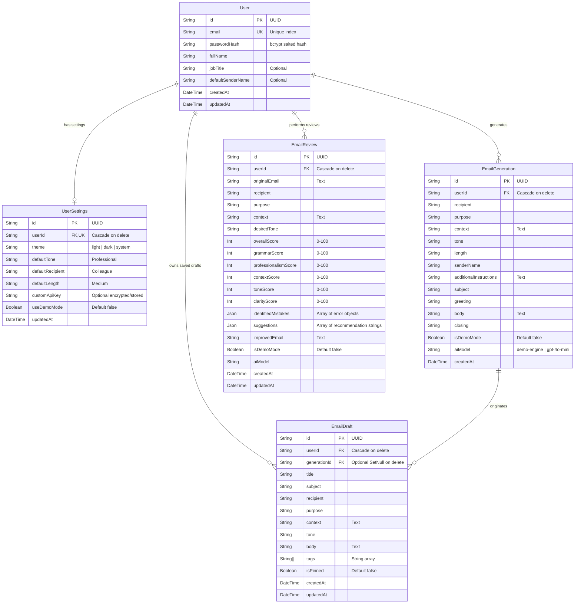

# MailCraft AI — Database Design & Schema Documentation
**Author:** Harsh Kumar  
**Database Engine:** PostgreSQL 18  
**ORM:** Prisma ORM (v6.19.3)  
**Database Name:** `mailcraft_db`  

---

## 1. Entity-Relationship Diagram (ERD)

---

## 2. Table Specifications & Indexes

### `User` Table
| Column | Type | Constraints | Description |
| :--- | :--- | :--- | :--- |
| `id` | UUID | PRIMARY KEY, DEFAULT gen_random_uuid() | Unique identifier |
| `email` | VARCHAR(255) | UNIQUE, NOT NULL, INDEXED | User email address |
| `passwordHash` | VARCHAR(255) | NOT NULL | bcrypt hash (10 salt rounds) |
| `fullName` | VARCHAR(255) | NOT NULL | Full name of user |
| `jobTitle` | VARCHAR(255) | NULLABLE | Professional role / academic status |
| `defaultSenderName` | VARCHAR(255) | NULLABLE | Configurable sign-off default |
| `createdAt` | TIMESTAMP | NOT NULL, DEFAULT NOW() | Account creation timestamp |
| `updatedAt` | TIMESTAMP | NOT NULL | Account update timestamp |

### `UserSettings` Table
| Column | Type | Constraints | Description |
| :--- | :--- | :--- | :--- |
| `id` | UUID | PRIMARY KEY | Settings unique identifier |
| `userId` | UUID | UNIQUE, NOT NULL, FK -> User.id (CASCADE) | 1-to-1 User relation |
| `theme` | VARCHAR(50) | NOT NULL, DEFAULT 'system' | Visual theme preference |
| `defaultTone` | VARCHAR(50) | NOT NULL, DEFAULT 'Professional' | Preferred drafting tone |
| `defaultRecipient`| VARCHAR(50) | NOT NULL, DEFAULT 'Colleague' | Preferred recipient category |
| `defaultLength` | VARCHAR(50) | NOT NULL, DEFAULT 'Medium' | Preferred email length |
| `customApiKey` | VARCHAR(255) | NULLABLE | Optional user-configured API key |
| `useDemoMode` | BOOLEAN | NOT NULL, DEFAULT FALSE | Flag to force local NLP engine |

### `EmailDraft` Table
* **Indexes:** `[userId, updatedAt]`, `[userId, recipient]`, `[userId, purpose]`
* **Foreign Keys:**
  * `userId` -> `User.id` (ON DELETE CASCADE)
  * `generationId` -> `EmailGeneration.id` (ON DELETE SET NULL)

### `EmailReview` Table
* **Indexes:** `[userId, createdAt]`
* **Foreign Keys:** `userId` -> `User.id` (ON DELETE CASCADE)
* **JSON Fields:**
  * `identifiedMistakes`: Stores structured array: `[{ id, type, original, suggestion, explanation, severity }]`
  * `suggestions`: Stores array of strategic recommendation strings

---

## 3. Data Integrity & Security Controls
1. **No Plaintext Passwords:** Passwords are never stored in plaintext; all credentials undergo `bcrypt.hash()` with 10 salt rounds.
2. **Strict User Isolation:** All private records (`EmailDraft`, `EmailReview`, `EmailGeneration`, `UserSettings`) enforce `where: { userId }` in every Prisma query to prevent unauthorized access.
3. **Cascading Deletions:** When a user account is deleted, all associated drafts, reviews, settings, and generation history are automatically cascaded.
