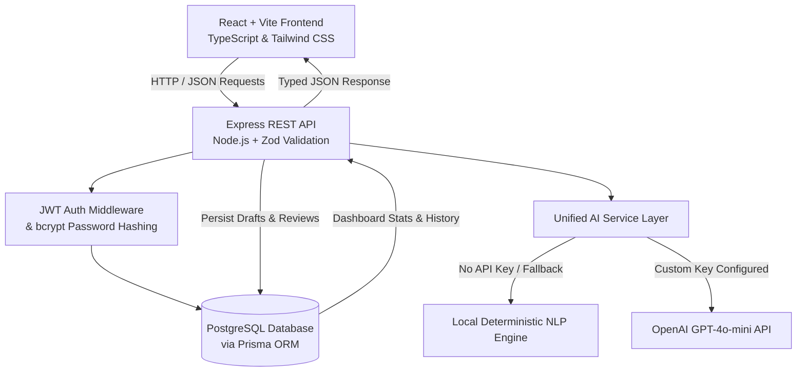

# MailCraft AI — Project Overview
**Student Name:** Harsh Kumar  
**Project Category:** Professional Productivity  
**Project Topic:** AI Email Drafting and Review Assistant  
**Semester & Sprint:** ITM Semester 3 — Sprint 2 — AI Tools Mini Project  

---

## 1. System Vision & Objective
Effective email communication is critical for academic success, internship placement, client management, and corporate operations. However, students and early-career professionals frequently struggle with:
* **Tone calibration:** Striking the appropriate balance between respectful formality and friendly collaboration.
* **Context omissions:** Forgetting critical deadlines, course codes, or deliverables.
* **Informal idioms & typos:** Using conversational slang like *"hey prof"*, *"asap"*, *"wanna"*, or improper punctuation in high-stakes emails.

**MailCraft AI** was engineered from scratch by **Harsh Kumar** to address both sides of the email workflow:
1. **Generative Drafting:** Creating complete, professional emails tailored by recipient, purpose, context, and tone.
2. **Analytical Review:** Rigorously auditing existing drafts across 5 distinct linguistic and professional dimensions.

---

## 2. High-Level Architecture Diagram

---

## 3. Core Modules Breakdown

### Module A: Intelligent Email Drafting
* **Inputs Captured:**
  * Recipient: Professor, Manager, HR, Client, Colleague, Customer, Friend, or Custom.
  * Purpose: Leave request, Assignment extension, Job application, Meeting request, Follow-up, Apology, Complaint, Business proposal, or Custom.
  * Context & Situation: Rich narrative details, dates, constraints, and commitments.
  * Tone: Professional, Formal, Friendly, Persuasive, Apologetic, Confident, Neutral.
  * Length: Short (1-2 concise paragraphs), Medium (structured body), Detailed (includes bullet points & deliverables).
  * Sender Name: Configurable per draft or user profile default.
* **Output Elements:**
  * Contextual Subject Line
  * Appropriate Salutation
  * Formatted Body Paragraphs
  * Etiquette-Conscious Closing & Sender Signature
* **Workspace Operations:**
  * Inline editable fields
  * One-click refinement actions (make shorter/longer, change tone, elevate professionalism)
  * Download as `.txt`
  * Direct persistence to PostgreSQL

### Module B: 5-Dimensional Email Review
* **Analysis Criteria:**
  1. **Grammar & Spelling:** Subject-verb agreement, homophones (*their/there*), capitalized pronouns, terminal punctuation.
  2. **Professionalism:** Salutations matching recipient status, elimination of texting abbreviations (*u, pls, thx, asap*), respectful closings.
  3. **Context Completeness:** Verifying whether key dates, reasons, and objectives from context notes are present in the text.
  4. **Tone Detection:** Automated categorization (e.g., Casual, Urgent/Demanding, Apologetic, Formal) versus requested target tone.
  5. **Clarity & Readability:** Sentence length auditing (flagging sentences > 28 words) and readability improvement.
* **Outputs Generated:**
  * Computed Quality Score (0–100) with visual radial gauge
  * Category score progress bars
  * Itemized mistakes with substring citations, explanations, severity tags, and replacement suggestions
  * Side-by-side or improved-only diff comparison
  * Interactive accept/reject toggles

---

## 4. UI/UX Design System
Inspired by leading modern SaaS interfaces (**Linear**, **Notion**, **Grammarly**, **Stripe**):
* **Color Palette:**
  * Primary: Deep Indigo (`#4F46E5` / `#4338CA`)
  * Accent: Electric Blue (`#38BDF8` / `#0EA5E9`)
  * Soft Background: `#F8FAFC` (Light) / `#0B0F19` (Dark Obsidian)
* **Accessibility:** Full keyboard navigability, high contrast text, visible focus rings, ARIA labels.
* **Feedback & Micro-interactions:** Animated radial gauges, progress bars, auto-dismissing toasts, and celebratory confetti upon draft creation and high review scores.
